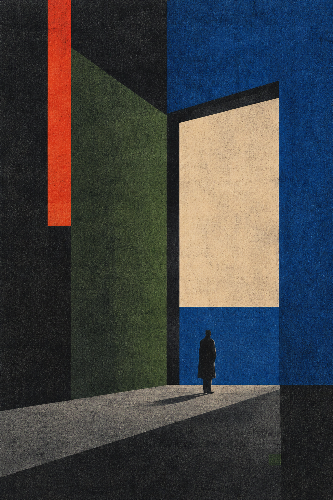

# 实际成图验收

## 验收图

- 文件：`visual-acceptance/kiuzyx-style-acceptance.png`
- 尺寸：1024 × 1536
- SHA256：`22A212F26DC4DFA0B011182A2E2BF2223E67C4B2530E1AFCAFCF5303B67ED5E7`
- 生成方式：ChatGPT 图像生成
- 最终提示词：`visual-acceptance/prompt.md`

## 量化色调

| 指标 | 验收图 | 近期 27 图均值 | 判断 |
| --- | ---: | ---: | --- |
| 平均明度 | 0.255 | 0.318 | 更暗，但仍处于参考图的低明度端 |
| 深阴影占比 | 76.9% | 56.4% | 明显更黑，暗部仍保留细颗粒与色差 |
| 高光占比 | 0.0% | 1.2% | 过少；没有泛光，但金属断点不够清楚 |
| 平均饱和度 | 0.339 | 0.628 | 总体更低；局部蓝、红、米白仍可辨 |
| 冷色像素 | 23.5% | 20.6% | 接近当前语料 |
| 暖色像素 | 14.5% | 31.6% | 偏少，事件色和暖中性停顿较弱 |
| 边缘密度 | 0.016 | 0.046 | 明显更安静 |
| 熵 | 4.39 | 5.08 | 信息密度较低，但表面仍有颗粒 |

## 四主轴验收

### 1. 色调

**1/2。** 深钴蓝、墨黑、暗绿、米白和朱红职责清楚，米白咬入蓝场、红色沿黑区建立事件，但整体显著暗于近期样本，暖中性面积不足，平均饱和度也偏低。它保留了体系骨架，却更接近极暗分支。

### 2. 构图

**2/2。** 正交墙面、竖向门框、低地平线和小人物形成清楚层级，约一半面积为低频负形；缩略图和灰度下均能读出主结构。

### 3. 图像质量与细节

**2/2。** 边缘清楚，细颗粒覆盖全图，暗部有抖动与纸张触感，没有塑料三维和泛光。不足之处是高光几近为零，小面积金属断点不够可读。

### 4. 整体视觉风格

**2/2。** 人物和具体空间只是承载物；忽略人物与门框后，仍保留下深蓝/米白/黑绿/朱红的明确块面和统一微颗粒，风格成立。

### 综合

| 维度 | 得分 |
| --- | ---: |
| 色彩面积与邻接 | 2/2 |
| 明度与高光 | 1/2 |
| 构图与负形 | 2/2 |
| 图像质量与微颗粒 | 2/2 |
| 材质断点 | 1/2 |
| 场景独立性 | 2/2 |
| **总计** | **10/12** |

**结论：通过，但属于偏暗、低饱和的实验分支。**

该图证明当前规则可以生成场景独立的色彩—质感体系，但下一轮应增加暖中性色面积、略微提升蓝/红局部饱和，并把金属断点做得更清楚。
