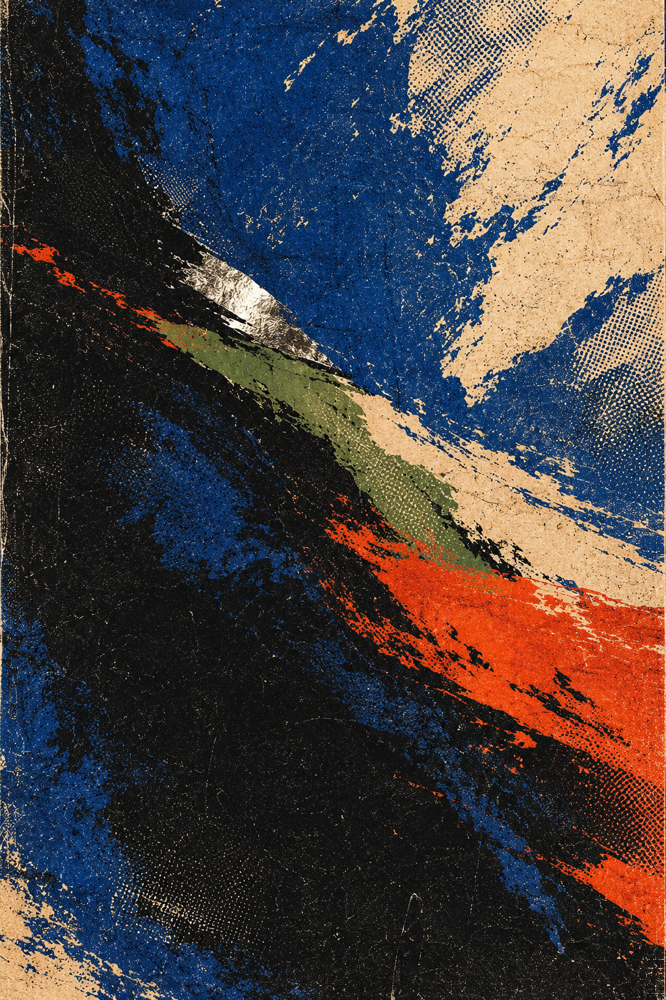

# 视觉验收：色彩结构与图像质感

## 验收原则

本技能的通过依据不是场景内容，而是：

1. 色块有没有明确的面积职责。
2. 颜色之间的相邻关系是否形成结构。
3. 冷暖与明度是否分层。
4. 印刷、半调、纸噪、套色错位和材料断点是否形成统一的图像质感。
5. 忽略人物、城市、建筑和故事之后，画面是否仍然像同一视觉体系。

场景只负责证明这些关系可以承载到具体内容上；它不是验收中心。

## 主验收样片

- 文件：`visual-acceptance/color-texture-study.png`
- SHA256：`6602B09978B1BFFDAB4D9A41FE2B16BE88E1F18E15D18F6A80242294D27E1E31`
- 提示词：`visual-acceptance/prompt.md`
- 生成方式：ChatGPT 图像生成
- 尺寸：1024 × 1536

该样片没有任何人物、城市、建筑或叙事场景。它只保留抽象色块、斜向质量轴、冷暖邻近、半调、粗糙油墨边界、纸纤维与小面积金属断点，用于验证技能能否脱离场景成立。

## 量化色调

主验收样片的表面统计：

| 指标 | 数值 | 解读 |
| --- | ---: | --- |
| 平均明度 | 0.259 | 明显中低明度，符合深色承重 |
| 深阴影占比 | 70.0% | 近黑与暗钴蓝承担主要面积 |
| 高光占比 | 0.1% | 金属断点未变成泛光 |
| 平均饱和度 | 0.399 | 强色集中，而不是全图平均高饱和 |
| 暖色像素占比 | 21.5% | 朱红/米白作为局部事件和呼吸 |
| 冷色像素占比 | 29.2% | 钴蓝形成次级冷色场 |
| 边缘密度 | 0.042 | 细节通过材质纹理而非碎屑堆叠出现 |
| 图像熵 | 4.88 | 有丰富表面，但没有被均匀噪声淹没 |

这些数值只用于验收这张成图，不是所有场景的固定配额。

## 色彩结构评分

| 维度 | 评分 | 观察 |
| --- | ---: | --- |
| 色块面积结构 | 2/2 | 墨黑、钴蓝、米白、朱红和苔绿面积明显不均 |
| 色彩邻近关系 | 2/2 | 米白咬入钴蓝，朱红横切黑区，苔绿形成短暂桥接 |
| 明度与高光 | 2/2 | 大面积深色承重，金属高光很小 |
| 图像质感 | 2/2 | 半调尺度、粗糙油墨边缘、纸纤维、干刷和套色错位可辨 |
| 材质断裂 | 1/2 | 金属断点可见，但略接近干刷高光，金属身份可以更明确 |
| 去场景辨识度 | 2/2 | 完全无具体场景，仍能辨认色彩与材质语言 |
| **总计** | **11/12** | 通过；保留一个可改进但不阻断交付的材质问题 |

## 验收结论

**通过。**

核心通过原因不是画面“像某个故事”，而是：

- 深色大面积承重与朱红小面积事件形成清楚层级。
- 米白不是空白，而是带纸张和半调质感的停顿区。
- 钴蓝与米白、朱红与黑、苔绿与两侧色块形成不同的邻接关系。
- 粗糙油墨边界、干刷、纸纤维、半调和套色错位共同构成连续表面。
- 去掉所有可识别对象后，画面仍保留同一套色彩结构与图像触感。
- 正式验收不保留场景样片，避免把“场景像不像”误当成风格通过标准。

补充盲测：

- **200px 缩略图**：仍能读出从左上钴蓝/米白斜向进入右下朱红的色块轴，以及大面积黑色承重。
- **灰度测试**：深黑、米白高光、中性蓝灰仍分层，颜色去掉后没有变成平均灰块。
- **去场景测试**：画面本身没有人物、城市、建筑或叙事，仍通过全部核心色彩与质感检查。

## 已知可改进项

- 金属断点可以更像真正的铬面或箔材，而不是干刷亮痕。
- 苔绿桥接面积很小，可增加约 1–2% 以强化冷暖之间的结构作用。
- 这些属于下一次变体优化，不改变本次 11/12 的通过结论。
